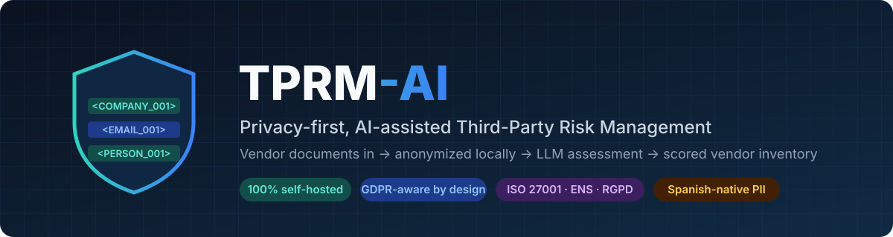
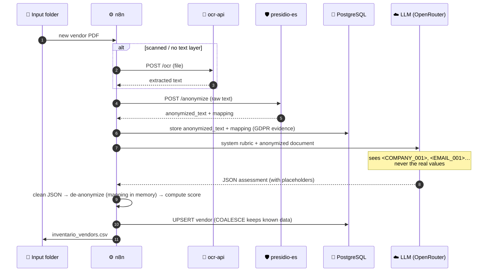
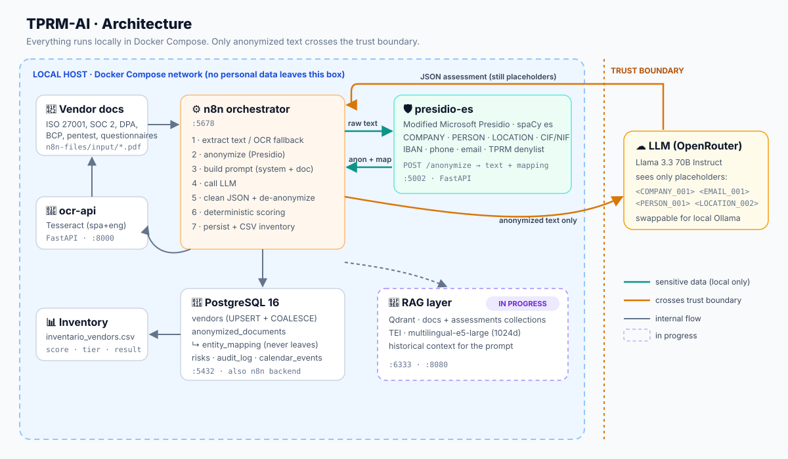
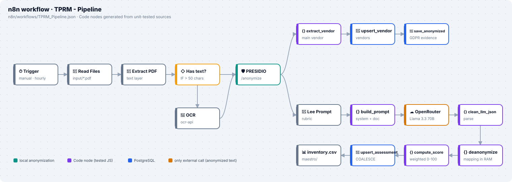

<p align="center">
  
</p>

<p align="center">
  <a href="https://github.com/cristianrdgzzz/tprm-ai/actions/workflows/ci.yml"></a>
  
  
  
  
  
  
  
</p>

<p align="center">
  <a href="#-the-problem">Problem</a> ·
  <a href="#-how-it-works">How it works</a> ·
  <a href="#-privacy-by-design">Privacy</a> ·
  <a href="#-risk-scoring-model">Scoring</a> ·
  <a href="#-results-on-a-real-run">Results</a> ·
  <a href="#-architecture">Architecture</a> ·
  <a href="#-quick-start">Quick start</a> ·
  <a href="#-project-status">Status</a> ·
  <a href="#-roadmap">Roadmap</a>
</p>

---

## 🎯 The problem

Every company that outsources a service inherits its supplier's risk. Under **ISO 27001 (A.5.19–A.5.23)**, **ENS**, **GDPR art. 28**, **NIS2** and **DORA**, organisations must assess their vendors before signing and keep that assessment alive afterwards.

In practice that means a GRC analyst reading a stack of PDFs per vendor — ISO certificate, SOC 2 summary, DPA, BCP/DRP, pentest report, sub-processor list, security questionnaire, cyber-insurance — and copying findings into a spreadsheet. It is slow, inconsistent between analysts, and **using a public AI to speed it up means sending the vendor's (and your own) personal data to a third party** — which is precisely the kind of risk TPRM exists to control.

## 💡 The solution

**TPRM-AI** is a self-hosted pipeline that turns a folder of vendor documents into a **scored, auditable vendor record**:

1. 📄 **Ingests** native or scanned PDFs (OCR fallback with Tesseract).
2. 🛡️ **Anonymizes locally** with a **modified Microsoft Presidio** tuned for Spanish corporate documents — companies, people, locations, CIF/NIF/NIE, IBAN, phones, emails — producing a **reversible mapping**.
3. 🤖 **Assesses with an LLM** that only ever sees placeholders like `<COMPANY_001>`, against a rubric aligned to **ISO 27001, ENS and GDPR**.
4. 🔁 **De-anonymizes locally**, computes a **deterministic weighted score**, flags **approval-blocking gaps** (no MFA, no DPA, no TIA, expired certificate, no PAM on critical tiers).
5. 🗄️ **Persists** the vendor in PostgreSQL with a GDPR evidence trail and exports a **vendor inventory CSV**.

> **One sentence:** the analyst drops PDFs in a folder; minutes later there is a scored vendor record — and no personal data ever left the machine.

---

## ⚙️ How it works



---

## 🔐 Privacy by design

The design principle is simple: **the only component outside the machine is the LLM, and it only receives anonymized text.**

| What | Where it lives | Leaves the host? |
|---|---|---|
| Original PDF and extracted text | `n8n-files/` (git-ignored) | ❌ never |
| Anonymized text | PostgreSQL + LLM request | ✅ only this |
| Reversible mapping (`<COMPANY_001>` → real name) | PostgreSQL `anonymized_documents.entity_mapping` | ❌ never — not sent to the LLM, not vectorised |
| Final assessment with real names | PostgreSQL `vendors` + CSV | ❌ never |

**Real example** (fictional vendor, real output format of `POST /anonymize`):

```text
IN   Certificado ISO/IEC 27001:2022 emitido por SGS ICS Iberia a TechNova Solutions S.L.
     Válido hasta: 14/03/2027. Datos alojados en Irlanda. DPO: dpo@technova-solutions.eu

OUT  Certificado ISO/IEC 27001:2022 emitido por <COMPANY_001> a <COMPANY_002>.
     Válido hasta: <DATE_TIME_001>. Datos alojados en <LOCATION_005>. DPO: <EMAIL_001>
```

```json
{ "COMPANY_001": "SGS ICS Iberia", "COMPANY_002": "TechNova Solutions S.L",
  "DATE_TIME_001": "14/03/2027", "LOCATION_005": "Irlanda", "EMAIL_001": "dpo@technova-solutions.eu" }
```

### Why a modified Presidio?

Out of the box, Presidio + spaCy produce many false positives and misses on Spanish corporate text (acronyms like *ISO, MFA, RPO, SLA* tagged as organisations; certificate numbers tagged as companies; multi-line spans). The fork in [`services/presidio-es`](services/presidio-es) adds:

- **Spanish enterprise recognizers** — `COMPANY` (legal suffixes S.L., S.A., S.L.U., S.A.U.), certification bodies with context, `PERSON`, `LOCATION`, CIF/NIF/NIE, IBAN, phone, email — replacing the noisy default spaCy entities.
- **TPRM denylist** — security acronyms (`iso, mfa, bcp, rpo, rto, sla, tia, dpo, soc, siem…`) are never anonymized, so the LLM can still reason about controls.
- **Span hygiene** — rejects spans with line breaks, >80 chars or >6 tokens, and resolves overlaps by highest score.
- **`MappingAnonymizerEngine` + `PlaceholderCounter`** — stable, per-type numbered placeholders and a flat reversible mapping.

Details: [`docs/PRESIDIO-ES.md`](docs/PRESIDIO-ES.md)

---

## 📊 Risk scoring model

The LLM scores each control **1–5** using an explicit rubric; the final score is then computed **deterministically in code** ([`compute_score.js`](n8n/code-nodes/compute_score.js), unit-tested), not trusted from the model.

| Section | Weight | Example controls |
|---|---:|---|
| 1 · Information security | **30%** | policy, risk analysis, incidents, audits, vulnerability mgmt |
| 2 · Identity & access (IAM) | **25%** | least privilege, MFA, leaver process, PAM, access reviews |
| 3 · Business continuity | **15%** | BCP/DRP (RTO/RPO recorded as data) |
| 4 · Data protection | **20%** | DPA, international transfers, TIA, breach notification |
| 5 · Cloud security | **5%** | cloud certifications, CSPM |
| 6 · Sub-processors | **5%** | flow-down of controls, cascade |

`score = Σ(section mean × weight) × 20` → **≥80 Approved** · **60–79 Approved with conditions** · **<60 Rejected** · missing evidence → **Incomplete assessment**.
Any **blocking gap** (no MFA on critical access, no DPA, transfer without TIA, expired certification, no PAM on tier 1/2) caps the result at **Rejected**.

More: [`docs/SCORING.md`](docs/SCORING.md)

---

## 🧪 Results on a real run

Two fictional vendors from [`samples/vendor-docs`](samples/vendor-docs) were processed end-to-end (synthetic documents: ISO 27001 certificate, SOC 2 summary, DPA, BCP/DRP, pentest, sub-processors, questionnaire, cyber-insurance).

| Vendor | What the LLM concluded | What TPRM-AI computes | Why |
|---|---|---|---|
| **CloudAtlas Digital S.L.** | `83.5` → *Aprobado* | **Evaluación incompleta** | No evidence for business continuity (0/1), data protection (1/7) or sub-processors (0/3) |
| **TechNova Solutions S.L** | *Evaluación incompleta* | **Evaluación incompleta** | International transfers with incomplete TIA |

This is exactly why the final score is **computed in code and not trusted from the model**: the LLM gave a high score from strong ISO 27001 and IAM evidence and ignored that three sections had no evidence at all. A TPRM analyst would not approve that vendor, and now neither does the pipeline.
Full output: [`samples/output/assessment_cloudatlas.json`](samples/output/assessment_cloudatlas.json)

```json
"secciones": {
  "s1": { "nombre": "Seguridad de la información", "evaluados": 7, "controles": 11, "media": 5 },
  "s2": { "nombre": "Gestión de accesos e identidades (IAM)", "evaluados": 4, "controles": 5, "media": 5 },
  "s3": { "nombre": "Continuidad de negocio", "evaluados": 0, "controles": 1, "media": null },
  "s4": { "nombre": "Protección de datos", "evaluados": 1, "controles": 7, "media": null },
  ...
}
```

---

## 🏗️ Architecture

<p align="center"></p>

| Component | Tech | Role | Why this choice |
|---|---|---|---|
| Orchestrator | **n8n** (self-hosted) | Ingestion, branching, HTTP calls, persistence | Visual, auditable pipeline that GRC teams can read and modify |
| Anonymization | **Presidio (fork) + spaCy `es_core_news_md`** behind FastAPI | Spanish PII detection + reversible mapping | Official recognizers failed on Spanish corporate text |
| OCR | **Tesseract** behind FastAPI | Scanned PDFs / images | Local, free, `spa+eng` |
| LLM | **Llama 3.3 70B** via OpenRouter | Rubric-based assessment → JSON | Strong reasoning at zero cost for the prototype; safe because input is anonymized. Swappable for local Ollama |
| Database | **PostgreSQL 16** | Vendor master, GDPR evidence, n8n backend | One reliable source of truth |
| Vector DB | **Qdrant** + **TEI multilingual-e5-large** | Historical context (RAG) | Self-hosted, good Spanish embeddings |
| Packaging | **Docker Compose** | One-command local deployment | Reproducible, isolated, ports bound to `127.0.0.1` |

Deep dive: [`docs/ARCHITECTURE.md`](docs/ARCHITECTURE.md) · Data model: [`docs/DATA-MODEL.md`](docs/DATA-MODEL.md) · Testing: [`docs/TESTING.md`](docs/TESTING.md)

---

## 🚀 Quick start

**Requirements:** Docker + Docker Compose, 8 GB+ RAM recommended, an [OpenRouter](https://openrouter.ai) API key (free tier works).

```bash
git clone https://github.com/cristianrdgzzz/tprm-ai.git && cd tprm-ai
cp .env.example .env                 # set passwords, N8N_ENCRYPTION_KEY, OPENROUTER_API_KEY
docker compose up -d --build         # postgres, qdrant, n8n, presidio-es, ocr-api
./scripts/healthcheck.sh             # every service should be ✔
./scripts/test-anonymize.sh          # try the Spanish anonymizer
```

Then open **n8n at http://localhost:5678**, import the workflow and drop PDFs into `n8n-files/input/`:

```bash
./scripts/import-workflows.sh                 # imports n8n/workflows/TPRM_Pipeline.json
cp samples/vendor-docs/*.pdf n8n-files/input/  # synthetic vendor pack
```

In n8n, create a **Postgres** credential named `TPRM Postgres` (host `postgres`, values from `.env`) and run the workflow.

<p align="center"></p>

Optional RAG layer:

```bash
docker compose --profile rag up -d && ./scripts/init-qdrant.sh
```

### API (presidio-es, port 5002)

| Method | Endpoint | Description |
|---|---|---|
| `GET` | `/health` | liveness + loaded language/model |
| `POST` | `/analyze` | detected entities with score and span (tuning/debug) |
| `POST` | `/anonymize` | `{text}` → `{anonymized_text, mapping}` |
| `POST` | `/deanonymize` | `{data, mapping}` → restores placeholders in text or JSON |

---

## 📁 Repository structure

```text
tprm-ai/
├── docker-compose.yml          # the whole stack; secrets come from .env
├── db/init/01_schema.sql       # PostgreSQL schema (auto-applied on first start)
├── services/
│   ├── presidio-es/            # FastAPI + modified Presidio (Spanish recognizers, mapping engine)
│   └── ocr-api/                # FastAPI + Tesseract (images and scanned PDFs)
├── n8n/
│   ├── code-nodes/             # source of every n8n Code node (unit-tested)
│   ├── sql/                    # parameterised queries used by Postgres nodes
│   └── workflows/              # importable workflow, generated by scripts/build_workflow.py
├── n8n-files/maestro/prompt_tprm.txt   # master assessment prompt (rubric + JSON template)
├── samples/                    # synthetic vendor documents + real pipeline output
├── scripts/                    # healthcheck, export/import workflows, qdrant init
├── tests/                      # unit tests for the Code nodes + e2e stubs
└── docs/                       # architecture, data model, scoring, roadmap, reports
```

---

## 📌 Project status

This is an **active personal project**, documented honestly:

| Capability | Status |
|---|---|
| PDF ingestion with OCR fallback | ✅ Working |
| Spanish PII anonymization with reversible mapping | ✅ Working |
| LLM assessment on anonymized text only | ✅ Working |
| Local de-anonymization + PostgreSQL persistence + CSV inventory | ✅ Working |
| GDPR evidence trail (`anonymized_documents`) | ✅ Working |
| Importable n8n workflow, executed end-to-end in a real n8n | ✅ Validated ([how](docs/TESTING.md)) |
| Deterministic weighted scoring + blocking gaps | ✅ Implemented & unit-tested |
| Main-vendor detection that ignores certification bodies | ✅ Implemented & unit-tested |
| Idempotent re-processing (content hash) | ✅ Implemented |
| Secrets moved out of the compose file | ✅ Done |
| RAG layer (Qdrant + local embeddings) | 🚧 Infrastructure ready, ingestion in progress |
| `PERSON` detection in complex Spanish names | 🚧 Known limitation (see [docs](docs/PRESIDIO-ES.md#known-limitations)) |
| Risk register, audit log, expiry calendar | 🗺️ Tables created, not wired yet |

## 🗺️ Roadmap

- [ ] Finish RAG ingestion (documents + past assessments) and inject vendor history into the prompt
- [ ] Improve `PERSON` recognizer and anonymize certificate numbers
- [ ] Few-shot examples in the prompt; optional fully-local LLM (Ollama) profile
- [ ] Populate `risks`, `audit_log` and certificate-expiry `calendar_events`
- [ ] Per-vendor Excel/PDF report and a small dashboard
- [ ] Map findings to NIS2 / DORA third-party requirements

Full list: [`docs/ROADMAP.md`](docs/ROADMAP.md)

---

## 🛡️ Security notes

- All service ports are bound to `127.0.0.1`; nothing is exposed to the network by default.
- Secrets live in `.env` (git-ignored). n8n credentials are never exported.
- Vendor documents, the database and n8n data are git-ignored — only synthetic samples are versioned.
- See [`SECURITY.md`](SECURITY.md) for reporting and known limitations.

---

## 👤 Author

**Cristian Rodríguez** — Computer Engineering (UOC) · Cloud & Security · ISO 27001 Foundation

Built to explore how GRC work can be automated with AI **without** trading away data protection — the same trade-off every TPRM programme faces.

## 📄 License

MIT — see [`LICENSE`](LICENSE). The modified Microsoft Presidio packages under `services/presidio-es/presidio/` keep their original MIT license and notice.
