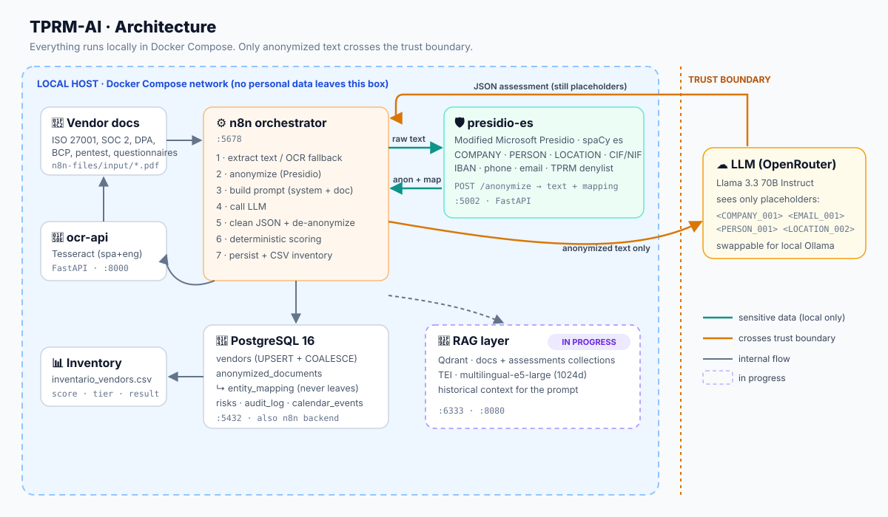

# Architecture

## Design principles

1. **Personal data never leaves the host.** Every component runs in Docker Compose on one machine. The LLM is the single external hop and only receives anonymized text.
2. **Reversible, auditable anonymization.** Each document keeps its anonymized text and mapping in PostgreSQL as GDPR evidence of exactly what was sent out.
3. **Don't trust the model with arithmetic.** The LLM extracts evidence and scores controls; the final weighted score and result are computed in code.
4. **Low-code where it helps the GRC team, code where it matters.** n8n makes the pipeline readable for non-developers; anonymization, scoring and parsing live in versioned, tested code.

## Services

| Service | Container | Port (host) | Image / build |
|---|---|---|---|
| PostgreSQL 16 | `tprm_postgres` | `127.0.0.1:5432` | `postgres:16` + `db/init/` |
| Qdrant | `tprm_qdrant` | `127.0.0.1:6333` | `qdrant/qdrant` |
| n8n | `tprm_n8n` | `127.0.0.1:5678` | `n8nio/n8n` |
| presidio-es | `presidio_anonymizer` | `127.0.0.1:5002` | `services/presidio-es` |
| ocr-api | `ocr_api` | `127.0.0.1:8000` | `services/ocr-api` |
| embedding-api *(profile `rag`)* | `tprm_embedding` | `127.0.0.1:8080` | `text-embeddings-inference:cpu-1.6` |

Containers talk to each other by service name on the compose network (`http://presidio_anonymizer:3000`, `http://ocr_api:8000`, `http://qdrant:6333`, `http://embedding-api:80`).

## Data flows

### A · Traceability branch
`PRESIDIO` → `extract_vendor` (main vendor + content hash) → upsert minimal vendor → insert `anonymized_documents` (`ON CONFLICT (content_sha256) DO NOTHING`).

### B · Assessment branch
`PRESIDIO` → read master prompt → `build_prompt` (system = rubric + JSON template, user = anonymized document) → OpenRouter → `clean_llm_json` → `deanonymize` (mapping in memory) → `compute_score` → upsert vendor with `COALESCE` → export inventory CSV.

### C · RAG (in progress)
- ✅ `vendor_id` FK on `anonymized_documents`
- ✅ embedding service (TEI + `intfloat/multilingual-e5-large`, 1024 d)
- ✅ Qdrant collections `vendors_docs` and `vendors_assessments` (`scripts/init-qdrant.sh`)
- 🚧 backfill: chunk anonymized text (400 words, 50 overlap, `passage:` prefix) → embed → upsert
- ⬜ assessments ingestion
- ⬜ retrieval in the main pipeline: top-5 document chunks + top-3 past assessments + current DB state injected into the prompt

The mapping is **never** vectorised — only anonymized text and administrative metadata go to Qdrant.

## Key decisions

| Decision | Alternatives considered | Reason |
|---|---|---|
| Anonymize before the LLM, de-anonymize after | Local-only LLM (Ollama) | 70B-class reasoning on a laptop is not feasible; anonymization makes a hosted model acceptable. Ollama remains a drop-in option. |
| Fork Presidio instead of configuring it | Default recognizers, regex only | Default spaCy entities were unusable on Spanish corporate documents. |
| Mapping kept in memory during the run, persisted only in PostgreSQL | Sending the mapping to the LLM | Sending the mapping would defeat the anonymization. |
| Deterministic scoring in code | Trust LLM `score_total` | LLM totals were often null or arithmetically inconsistent. |
| Single PostgreSQL for project + n8n | Separate DBs | Simplicity for a single-node deployment. |
| `UPSERT … COALESCE` | Overwrite | A new document that doesn't mention a field must not erase known data. |
