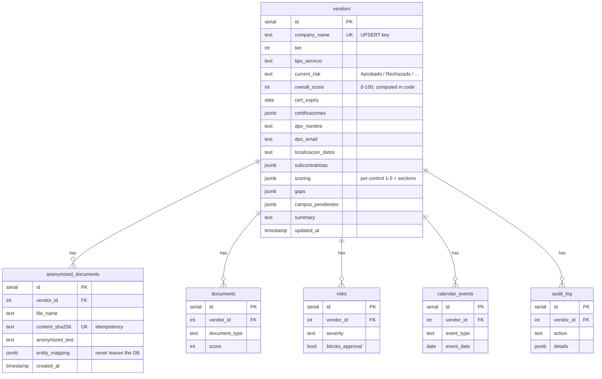

# Data model

Schema: [`db/init/01_schema.sql`](../db/init/01_schema.sql) — applied automatically the first time the PostgreSQL volume is created.

| Table | Status |
|---|---|
| `vendors` | ✅ used by the pipeline |
| `anonymized_documents` | ✅ used by the pipeline |
| `documents`, `risks`, `calendar_events`, `audit_log` | 🗺️ created for the next phases |

n8n creates its own internal tables (`execution_*`, `workflow_*`, …) in the same database.

## Qdrant collections (RAG, in progress)

| Collection | Vector | Payload |
|---|---|---|
| `vendors_docs` | 1024, cosine | `vendor_id, document_id, file_name, chunk_index, chunk_text` |
| `vendors_assessments` | 1024, cosine | `vendor_id, tier, score, assessment_text` |
