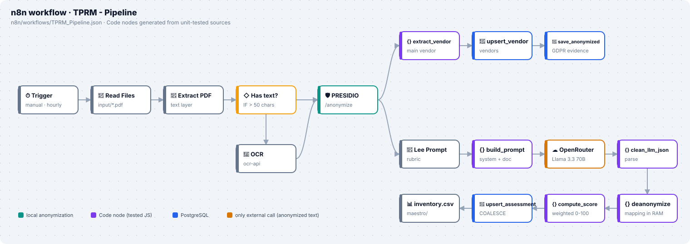

# n8n — pipeline orchestration

n8n runs the whole assessment pipeline. The importable workflow is **generated from the tested sources** in this folder, so the JSON never drifts from the code:

```bash
python3 scripts/build_workflow.py   # code-nodes/*.js + sql/*.sql → workflows/TPRM_Pipeline.json
./scripts/import-workflows.sh       # workflows/*.json → running n8n
./scripts/export-workflows.sh       # running n8n → workflows/ (if you edit it in the UI)
```

After importing, create a **Postgres** credential named `TPRM Postgres` (host `postgres`, port `5432`, values from `.env`). The OpenRouter key is read from the environment (`$env.OPENROUTER_API_KEY`), never stored in the workflow.



> Credentials are never exported. Set the OpenRouter key in `.env` (`OPENROUTER_API_KEY`) and reference it as `{{ $env.OPENROUTER_API_KEY }}`.

## Folder contents

| Path | What it is |
|---|---|
| `code-nodes/*.js` | Source of every **Code** node, unit-tested with `npm test`. Paste the file into the node (the `if (typeof $input ...)` block is the n8n entry point). |
| `sql/*.sql` | Queries used by the **Postgres** nodes (parameterised: `$1, $2…`). |
| `workflows/TPRM_Pipeline.json` | Importable workflow (27 nodes incl. sticky notes), generated by `scripts/build_workflow.py`. |

## Main workflow: `TPRM - Pipeline`

```mermaid
flowchart LR
    A[Schedule / Read Files<br/>n8n-files/input/*.pdf] --> B[Extract PDF]
    B --> C{Has text layer?}
    C -- no --> D[HTTP → ocr-api /ocr]
    C -- yes --> E[Merge 'PDF']
    D --> E
    E --> F[HTTP → PRESIDIO<br/>/anonymize]
    F --> G[extract_vendor.js]
    G --> H[(SQL 01 upsert vendor)]
    H --> I[(SQL 02 anonymized_documents)]
    F --> J[Lee Prompt<br/>maestro/prompt_tprm.txt]
    J --> K[build_prompt.js]
    K --> L[HTTP → OpenRouter]
    L --> M[clean_llm_json.js]
    M --> N[deanonymize.js]
    N --> O[compute_score.js]
    O --> P[(SQL 03 upsert assessment)]
    P --> P2[Move to processed]
    P2 --> Q[(SQL 04 inventory)]
    Q --> R[CSV → maestro/inventario_vendors.csv]
```



| # | Node (name used in expressions) | Type | Config |
|---|---|---|---|
| 1 | `Manual Trigger` / `Every hour` → `Read Files` | Triggers + Read/Write Files from Disk | `/home/node/.n8n-files/input/*.pdf` |
| 2 | `Extract PDF` | Extract from File (PDF) | keeps the binary for the OCR branch |
| 3 | `Has text layer?` | If | `{{ ($json.text || '').trim().length }} > 50` |
| 4 | `OCR` | HTTP Request | `POST http://ocr_api:8000/ocr`, form-data `file` = binary `data` |
| 5 | `PDF` | Edit Fields (Set) | normalises both branches to `{ text, file_name }` |
| 6 | `PRESIDIO` | HTTP Request | `POST http://presidio_anonymizer:3000/anonymize`, JSON `{ "text": {{ JSON.stringify($json.text) }}, "language": "es" }` |
| 7 | `extract_vendor` | Code | `code-nodes/extract_vendor.js` |
| 8 | `upsert_vendor` | Postgres (Execute Query) | `sql/01_upsert_vendor_minimal.sql` |
| 9 | `save_anonymized` | Postgres (Execute Query) | `sql/02_insert_anonymized_document.sql` |
| 10 | `Lee Prompt` → `Prompt as text` | Read File + Extract from File (text) | `/home/node/.n8n-files/maestro/prompt_tprm.txt` |
| 11 | `build_prompt` | Code | `code-nodes/build_prompt.js` |
| 12 | `OpenRouter` | HTTP Request | `POST https://openrouter.ai/api/v1/chat/completions`, header `Authorization: Bearer {{ $env.OPENROUTER_API_KEY }}`, body = `{{ $json }}` |
| 13 | `clean_llm_json` | Code | `code-nodes/clean_llm_json.js` |
| 14 | `deanonymize` | Code | `code-nodes/deanonymize.js` (mapping from `$('PRESIDIO')`, in memory) |
| 15 | `compute_score` | Code | `code-nodes/compute_score.js` (deterministic score) |
| 16 | `upsert_assessment` | Postgres (Execute Query) | `sql/03_upsert_vendor_assessment.sql`, params from `$json.db` |
| 17 | `Move to processed` | Execute Command | moves the PDF to `n8n-files/processed/` so it is not assessed twice |
| 18 | `inventory` → `CSV` → `Write inventory` | Postgres + Convert to File + Write File | `sql/04_export_inventory.sql` (runs once) → `maestro/inventario_vendors.csv` |

> In the original workflow some nodes have Spanish names: `convertir_a_json` = `build_prompt`, `limpiar_json` = `clean_llm_json`, `desanonimizar` = `deanonymize`. Keep the name `PRESIDIO` for the anonymization node — the Code nodes reference it with `$('PRESIDIO')`.

### Privacy invariant

Node 12 (OpenRouter) is the **only** node that talks to the internet, and it only receives the output of node 11, which contains the anonymized text. The `mapping` is read from `$('PRESIDIO')` *after* the LLM answers, in node 14, and is persisted only in PostgreSQL (node 9).
